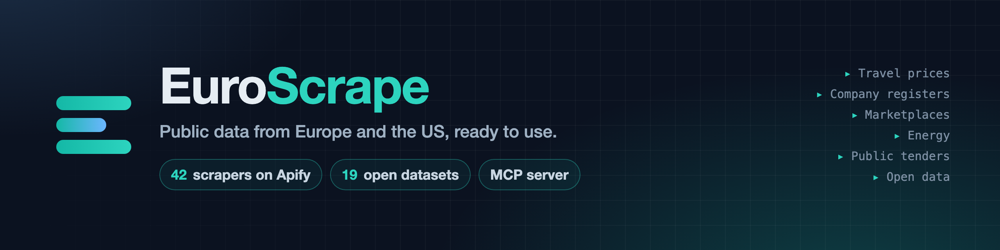

**Ready-to-use cloud scrapers on [Apify](https://apify.com/euroscrape?fpr=53ztcw).** No code, no servers: run them, schedule them, get alerts, pay only per result.

| | Actor | What you get |
|---|---|---|
| 🏨 | [Google Hotels Scraper](https://apify.com/euroscrape/google-hotels-prices?fpr=53ztcw) | Unofficial Google Hotels API: hotel prices on every booking site, rate parity, price calendars, price-drop alerts |
| 🛫 | [Ryanair Low Fare Finder](https://apify.com/euroscrape/ryanair-low-fares?fpr=53ztcw) | Fare calendars, every destination under your price cap, deal alerts |
| ✈️ | [Google Flights Scraper](https://apify.com/euroscrape/google-flights-prices?fpr=53ztcw) | Unofficial Google Flights API: cheapest day to fly, price calendar, typical price range, CO2, price-drop alerts |
| 🧾 | [EU VAT Validator (VIES)](https://apify.com/euroscrape/vat-validator?fpr=53ztcw) | Bulk checks against the official EU registry, audit proof, deregistration alerts |
| ⛽ | [France Fuel Prices](https://apify.com/euroscrape/france-fuel-prices?fpr=53ztcw) | Official live prices of every French station, cheapest near you, drop alerts |
| 🏠 | [France Energy Ratings (DPE)](https://apify.com/euroscrape/france-energy-ratings?fpr=53ztcw) | Official energy certificates of French homes, F/G energy sieves by city, new-certificate alerts |
| 🏗️ | [France Building Permits (Sitadel)](https://apify.com/euroscrape/france-building-permits?fpr=53ztcw) | Official building permits: housing programmes and commercial buildings, the developer behind each, alerts when works start |
| ⚡ | [EU Electricity Prices](https://apify.com/euroscrape/eu-electricity-prices?fpr=53ztcw) | Day-ahead spot prices for 40+ zones, cheapest 3-hour window, negative-price alerts |
| 🏛️ | [EU Public Tenders Scraper](https://apify.com/euroscrape/eu-public-tenders?fpr=53ztcw) | Tenders and contract awards from all of Europe (TED) and France (BOAMP, DECP), winners per lot |
| 👗 | [Vinted Scraper](https://apify.com/euroscrape/vinted-scraper?fpr=53ztcw) | Unofficial Vinted API: 26 countries, prices with fees, seller ratings, alerts on new listings and price drops |
| ♻️ | [EU Second-Hand Marketplaces Scraper](https://apify.com/euroscrape/eu-marketplace-deals?fpr=53ztcw) | Vinted, OLX, Marktplaats, Kleinanzeigen… in 18 countries, prices in €, cheapest country |
| ⭐ | [App Store & Google Play Reviews Scraper](https://apify.com/euroscrape/app-reviews?fpr=53ztcw) | Reviews from both stores in 58 countries, rating by version, alerts on negative reviews |
| 🧩 | [Website Tech Stack Detector](https://apify.com/euroscrape/website-intelligence?fpr=53ztcw) | 280+ technologies, company identity, contacts and sales signals for any website |
| ⚖️ | [Impressum & Legal Notice Scraper](https://apify.com/euroscrape/company-identity?fpr=53ztcw) | Legal name, registry numbers and VAT IDs from any European website |
| 🏠 | [France Property Prices (DVF)](https://apify.com/euroscrape/france-property-prices?fpr=53ztcw) | Real sold prices, €/m² and trends for any French city, from official records |
| 🛒 | [Trusted Shops Scraper](https://apify.com/euroscrape/trusted-shops-scraper?fpr=53ztcw) | Online shops of 11 European markets with company, contacts, rating and review volume; customer reviews; alerts on negative reviews |
| 🇫🇷 | [French Companies Scraper](https://apify.com/euroscrape/france-companies?fpr=53ztcw) | Every French company from SIRENE, with finances, websites and emails |
| 🇬🇧 | [UK Companies House Scraper](https://apify.com/euroscrape/uk-companies?fpr=53ztcw) | UK companies by SIC code and location, with officers, websites and emails |
| 🆕 | [No-Website Leads](https://apify.com/euroscrape/no-website-leads?fpr=53ztcw) | Newly registered companies with no website yet (UK, France, and Texas, New York, Colorado, Connecticut, Oregon), from the official registers, with the creation date of their domain name |
| 🇩🇪 | [Kleinanzeigen Scraper](https://apify.com/euroscrape/kleinanzeigen-scraper?fpr=53ztcw) | Unofficial Kleinanzeigen API: German classifieds with deal score, view counts and instant alerts |

📁 Ready-to-run Python examples: [apify-examples](https://github.com/EuroScrape-eu/apify-examples) · 🤖 MCP server for AI agents: [euroscrape-mcp](https://github.com/EuroScrape-eu/euroscrape-mcp)
✍️ Articles & guides: [euroscrape.com/articles](https://euroscrape.com/articles/)

Links to apify.com carry EuroScrape's Apify affiliate code: if you take a paid Apify plan, Apify may pay EuroScrape a commission, at no cost to you.
